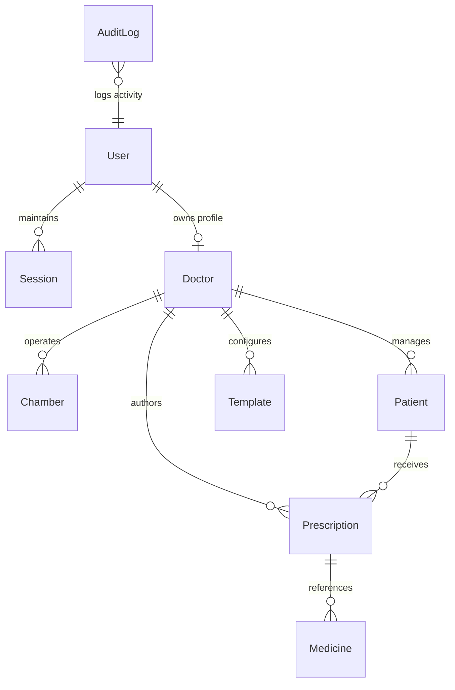

# docPresc Database Architecture & Schema Guide

docPresc utilizes **MongoDB** with **Mongoose ODM**. The database layer is designed for high-throughput reads, concurrency-safe unique ID generation, and multi-tenant doctor isolation.

---

## 1. Collections & Relationships



---

## 2. Collections Overview

### `users`
- Stores authentication credentials, bcrypt password hashes, account role (`doctor` | `admin`), and status (`active` | `pending` | `suspended`).
- Indexes:
  - `{ email: 1 }` (Unique)
  - `{ role: 1, status: 1 }`

### `doctors`
- Stores clinical profile, BMDC registration number, qualifications, specializations, institution registration numbers, signature URL, and consultation settings.
- Indexes:
  - `{ userId: 1 }` (Unique)
  - `{ bmdcNumber: 1 }` (Sparse Unique)
  - `{ registrationNumber: 1 }`

### `patients`
- Electronic medical record (EMR) for patients registered under a doctor.
- ID format: `PAT-YYYY-XXXX` (e.g. `PAT-2026-0001`).
- Indexes:
  - `{ doctorId: 1, patientId: 1 }` (Unique)
  - `{ doctorId: 1, status: 1, createdAt: -1 }` (Doctor list retrieval)
  - `{ doctorId: 1, name: "text", phone: "text" }` (Search)

### `prescriptions`
- Digital clinical prescriptions created by doctors.
- Statuses: `DRAFT` (editable), `FINALIZED` (immutable).
- ID format: `RX-YYYY-XXXXXX` (e.g. `RX-2026-000001`).
- Indexes:
  - `{ doctorId: 1, prescriptionId: 1 }` (Unique)
  - `{ doctorId: 1, status: 1, createdAt: -1 }` (Doctor list retrieval)
  - `{ patientId: 1, createdAt: -1 }` (Patient visit history)
  - `{ shareToken: 1 }` (Public QR verification lookup)

### `medicines`
- National Bangladeshi formulary catalog comprising 26,373+ medicines across Allopathic, Unani, Ayurvedic, and Herbal classifications.
- Indexes:
  - `{ brandName: "text", genericName: "text" }` (Compound full-text autocomplete)
  - `{ medicineType: 1, brandName: 1 }`
  - `{ genericName: 1 }`

### `counters`
- Atomic sequence store for concurrency-safe unique ID generation.
- Schema: `{ _id: String, seq: Number }`
- Utilizes MongoDB atomic `findOneAndUpdate({ $inc: { seq: 1 } })` to eliminate race conditions under concurrent submissions.

### `sessions`
- Server-side token family sessions for refresh token rotation and token reuse detection.
- Indexes:
  - `{ refreshTokenHash: 1 }` (Unique)
  - `{ userId: 1, isValid: 1 }`
  - `{ familyId: 1 }`
  - `{ expiresAt: 1 }` (TTL index for automatic MongoDB expiration)

### `password_reset_otps`
- 6-digit cryptographic OTP challenges for password recovery.
- Indexes:
  - `{ email: 1 }` (Unique)
  - `{ expiresAt: 1 }` (TTL expiration)

---

## 3. Concurrency-Safe Atomic Sequence ID Generation

Previous versions relied on `countDocuments()` to determine the next ID, which caused collisions when doctors submitted prescriptions concurrently.

The new implementation uses the `Counter` collection:
```ts
export const generateNextPatientId = async (): Promise<string> => {
  const currentYear = new Date().getFullYear();
  const counterId = `patient_${currentYear}`;

  while (true) {
    const counter = await Counter.findByIdAndUpdate(
      counterId,
      { $inc: { seq: 1 } },
      { new: true, upsert: true }
    );

    const patientId = `PAT-${currentYear}-${counter.seq.toString().padStart(4, '0')}`;
    const exists = await Patient.exists({ patientId });
    if (!exists) {
      return patientId;
    }
  }
};
```
MongoDB's `$inc` operator is executed atomically in the storage engine, guaranteeing 100% collision-free monotonic sequence IDs.
