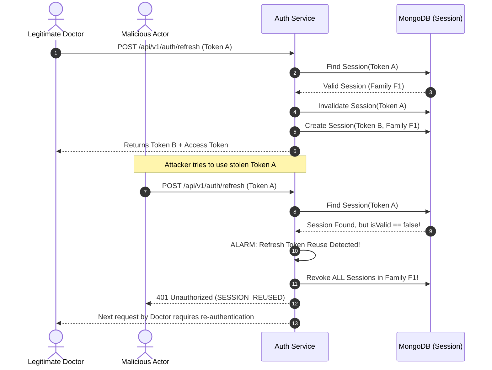

# docPresc Security Architecture & Hardening Guide

docPresc implements defense-in-depth security standards tailored for medical data privacy, HIPAA/GDPR clinical principles, and Bangladesh Medical & Dental Council (BMDC) compliance.

---

## 1. Threat Mitigation Matrix

| Threat Category | Potential Impact | Implemented Mitigation | Verification |
|---|---|---|---|
| **IDOR (Cross-Doctor Access)** | Doctor B reads or alters Doctor A's patient or prescription records | All patient and prescription queries are strictly scoped with `doctorId: req.doctor._id` at the service/repository layer. | Automated Test Suite 3 & Suite 8 |
| **Token Theft & Replay** | Attacker intercepts stolen refresh token to maintain permanent access | Refresh Token Rotation with Token Family Reuse Detection. Re-presenting a consumed token invalidates the entire session family immediately. | Automated Test Suite 6 |
| **Accidental Data Wipe** | Destructive seeds wipe production Atlas database during testing | Seed operations require explicit `ALLOW_DESTRUCTIVE_RESET=true` environment flag and are permanently disabled in production (`NODE_ENV=production`). | Automated Test Suite 5 |
| **Test Database Pollution** | Automated tests write mock data to live MongoDB Atlas cluster | `backend/src/config/db.ts` automatically runs tests on an isolated in-memory `MongoMemoryServer` instance if `MONGODB_TEST_URI` is not explicitly set. | Automated Test DB Guard |
| **Cross-Origin Credential Hijacking** | Malicious third-party websites make authenticated API calls | Strict CORS allowlist matching `CORS_ORIGIN`. Wildcard reflection with credentials (`credentials: true` + `*`) is blocked. | App CORS Configuration |
| **Email/Account Enumeration** | Attackers probe API to find registered doctor email addresses | `/auth/forgot-password` and `/auth/resend-otp` return identical generic success messages regardless of email existence. | Auth Service Implementation |
| **OTP Brute Force** | Attackers brute force 6-digit password reset codes | Max 5 verification attempts per OTP challenge; challenge is locked upon 5th failure. Cryptographic constant-time comparison prevents timing attacks. | OTP Service Implementation |
| **Draft Prescription Exposure** | Public QR scan exposes draft or unverified prescriptions | Public sharing is strictly restricted to `status: FINALIZED` non-revoked prescriptions with cryptographically secure tokens. | Automated Test Suite 4 |
| **Hardcoded Default Admin** | Default admin password (`Admin123!`) exploited in production | Removed automatic seeding of plaintext admin in production. Mandates explicit environment-based administrative provisioning. | Seed & Env Validation |

---

## 2. Authentication & Session Security

### Short-Lived Access Tokens + HttpOnly Refresh Tokens
- **Access Token**: Short-lived (15 minutes), signed using HMAC-SHA256 with `JWT_SECRET`. Carried in Authorization header (`Bearer <token>`) or `token` cookie.
- **Refresh Token**: Long-lived (7 to 30 days), stored as cryptographically random hex (80 bytes of entropy). Stored in MongoDB `Session` collection as a SHA-256 hash.
- **Cookie Security**:
  ```ts
  res.cookie('refreshToken', rawRefreshToken, {
    httpOnly: true,
    secure: process.env.NODE_ENV === 'production',
    sameSite: process.env.NODE_ENV === 'production' ? 'none' : 'lax',
    path: '/',
    maxAge: days * 24 * 60 * 60 * 1000,
  });
  ```

### Refresh Token Rotation & Reuse Detection


---

## 3. Data Scoping & Anti-IDOR Implementation

In `patient.repository.ts` and `prescription.repository.ts`, queries are strictly bound to `doctorId`:

```ts
// Example: Safe doctor-scoped lookup
async findScopedById(id: string, doctorId: Types.ObjectId | string): Promise<IPatient | null> {
  return Patient.findOne({
    _id: new mongoose.Types.ObjectId(id),
    doctorId: new mongoose.Types.ObjectId(doctorId.toString()),
    status: 'active',
  });
}
```

Even if a malicious user submits another doctor's patient ID, the database returns `null`, and the service layer throws `NotFoundError('Patient record not found or access unauthorized.')`.

---

## 4. Public Prescription Share Security

1. **Finalized-Only**: `status: FINALIZED` is mandatory. Draft prescriptions reject public lookup.
2. **Expiration Enforcement**: Tokens carry `shareExpiresAt`. Expired tokens return `404 Not Found`.
3. **Instant Revocation**: Doctors can call `DELETE /api/v1/prescriptions/:id/share` at any time to invalidate the token.
4. **PII Redaction**: The public DTO strips private doctor notes, patient phone numbers, emails, emergency contacts, addresses, and internal database audit metadata. Only clinical prescription details (medicines, dosage, diagnosis) are rendered.
