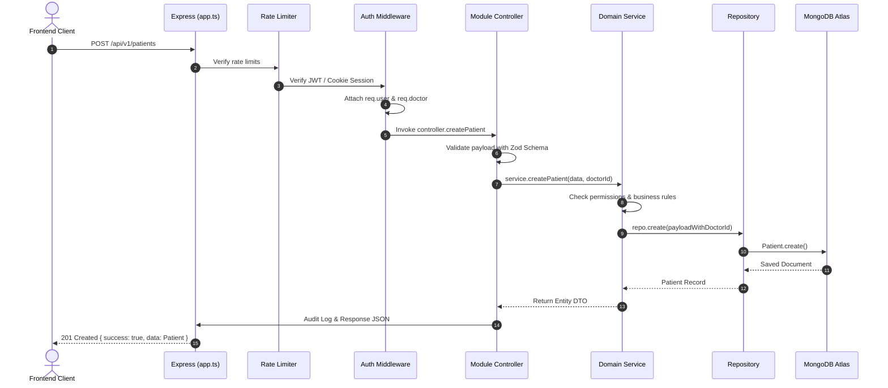

# docPresc Architecture Guide
## Modular Monolith with Clean Layered Architecture

docPresc is engineered as a high-reliability **Modular Monolith** with a **Clean Layered Architecture**. It combines enterprise security, doctor-scoped data isolation, and clinical usability in a unified codebase without the operational overhead of microservices.

---

## 1. Architectural Philosophy

1. **Modular Monolith**: Code is partitioned into domain-driven modules (`auth`, `patients`, `prescriptions`, `medicines`, `chambers`, `templates`, `admin`, `uploads`). Modules encapsulate their domain models, business logic, persistence operations, and HTTP controllers.
2. **Clean Layered Separation**:
   - **Routes**: HTTP method and endpoint routing, authentication middleware, schema validation middleware, rate limiters.
   - **Controllers**: Request unwrapping, parameter extraction, delegation to domain services, audit logging, and standard HTTP response shaping.
   - **Services**: Pure business logic, authorization verification (doctor scoping), orchestrations, transactional side effects.
   - **Repositories**: Data access layer isolating Mongoose queries from business logic.
   - **Models**: Database schema definitions, compound indexes, type definitions, and validation constraints.
3. **Strict Zero-Trust Ownership (Anti-IDOR)**:
   Every patient and prescription operation is strictly scoped to the requesting doctor at the service and repository level. An authenticated doctor can never access or modify another doctor's records, even if an internal MongoDB ObjectId is guessed or provided.
4. **Dual-Route Compatibility**:
   All endpoints are available under the versioned `/api/v1/*` tree while legacy `/api/*` and `/` routes remain fully operational for backward compatibility.

---

## 2. Directory Hierarchy

```
backend/src/
├── config/                     # Environment, Database, and Cloudinary configuration
│   ├── env.ts                  # Zod-validated environment schema & fail-fast checks
│   ├── db.ts                   # Connection management with automatic MongoMemoryServer test fallback
│   └── cloudinary.ts           # Cloudinary SDK client configuration
│
├── modules/                    # Domain-Driven Business Modules
│   ├── auth/                   # Registration, Login, Token Refresh Rotation, Password Reset
│   │   ├── auth.types.ts
│   │   ├── auth.validation.ts
│   │   ├── auth.service.ts
│   │   ├── auth.controller.ts
│   │   ├── auth.routes.ts
│   │   └── index.ts
│   ├── patients/               # Patient Registry, Demographics, Visit History
│   │   ├── patient.types.ts
│   │   ├── patient.validation.ts
│   │   ├── patient.repository.ts
│   │   ├── patient.service.ts
│   │   ├── patient.controller.ts
│   │   ├── patient.routes.ts
│   │   └── index.ts
│   ├── prescriptions/          # Prescription Lifecycle, Immutability, Duplication, Sharing
│   │   ├── prescription.types.ts
│   │   ├── prescription.validation.ts
│   │   ├── prescription.repository.ts
│   │   ├── prescription.service.ts
│   │   ├── prescription.controller.ts
│   │   ├── prescription.routes.ts
│   │   └── index.ts
│   ├── medicines/              # 26,373+ Allopathic, Unani, Ayurvedic Formulary Catalog
│   │   ├── medicine.types.ts
│   │   ├── medicine.validation.ts
│   │   ├── medicine.repository.ts
│   │   ├── medicine.service.ts
│   │   ├── medicine.controller.ts
│   │   ├── medicine.routes.ts
│   │   └── index.ts
│   ├── chambers/               # Doctor Consultation Chamber Locations & Schedules
│   ├── templates/              # Clinical Prescription Templates
│   ├── admin/                  # System Telemetry, Doctor Verification, Audit Log Viewer
│   └── uploads/                # Signature and Image Processing
│
├── shared/                     # Cross-Cutting Core Utilities
│   ├── errors/                 # AppError, NotFoundError, ForbiddenError, UnauthorizedError
│   ├── middleware/             # Central Error Handler, Role Guards, Audit Interceptor
│   ├── utils/                  # Concurrency-safe ID generators, asyncHandler
│   ├── types/                  # Shared TypeScript Interfaces
│   └── constants/              # System-wide Enums and Configuration Constants
│
├── infrastructure/             # External Integrations & Storage Abstractions
│   ├── storage/                # IStorageService, Cloudinary & LocalBase64 implementations
│   └── email/                  # Nodemailer SMTP and Template Dispatcher
│
├── routes/                     # Central Routing Trees
│   ├── v1/index.ts             # Versioned API v1 Router
│   └── index.ts                # Legacy Canonical Router
│
├── docs/                       # OpenAPI 3.0 Specifications & Swagger UI
│   └── openapi.ts
│
├── app.ts                      # Express Application Factory, Middleware Pipeline
└── server.ts                   # HTTP Server Entrypoint with Graceful Shutdown
```

---

## 3. Request Lifecycle



---

## 4. API Versioning & Documentation

- **Base URL v1**: `/api/v1/*`
- **Interactive Swagger UI**: `/api/v1/docs` (and `/api-docs` redirect)
- **Machine-Readable OpenAPI Specification**: `/api/v1/openapi.json`
- **Health Probes**:
  - `/api/health/liveness`: Checks process availability and uptime.
  - `/api/health/readiness`: Checks MongoDB connectivity; returns HTTP 503 if disconnected.
